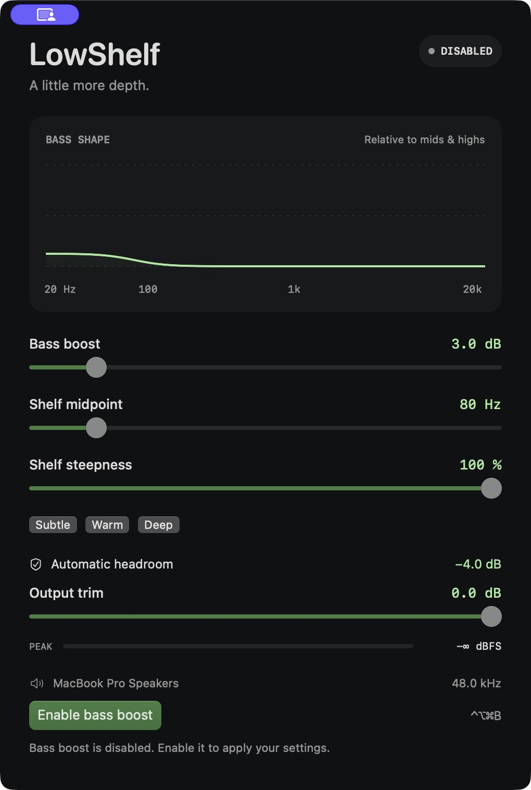
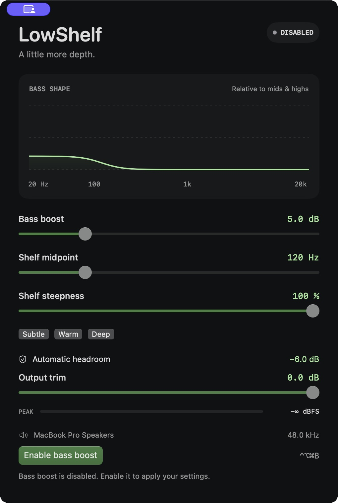
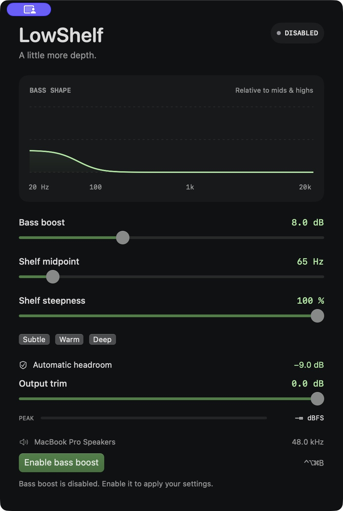

# LowShelf

A native macOS equalizer for a little more bass. Adjust the sound across your Mac, choose a preset, and toggle it from the menu bar or a keyboard shortcut.

No accounts, network access, or audio uploads. Requires **macOS 14.2 or later** and a stereo output.

## A shape for your sound

| Subtle | Warm | Deep |
| --- | --- | --- |
|  |  |  |

- Adjust bass boost, frequency, and steepness with a live response curve.
- Automatic headroom reduces clipping risk; output trim provides extra room.
- Toggle from anywhere with **Control–Option–Command–B**.
- Optionally launch at login and enable bass boost when headphones connect.
- Settings are saved between launches. Closing the window leaves the menu-bar controls available.

## Build and run

A signed, notarized download is not available yet. Build locally with Apple's Command Line Tools and Swift 6; full Xcode is optional.

```sh
git clone https://github.com/rmessenger/low-shelf.git
cd low-shelf
./scripts/build.sh
open dist/LowShelf.app
```

The build targets your Mac's architecture and is locally signed, not notarized.

Click **Enable bass boost** and allow system audio capture if macOS asks. LowShelf processes playback in memory; it never saves or uploads audio. Permission is managed in **System Settings → Privacy & Security → Screen & System Audio Recording**. Rebuilding with local signing may require granting permission again.

Start with **Subtle**. Bass boost lowers mids and highs to leave headroom, so adjust your playback volume gently. Disabling the effect restores normal playback and may sound louder.

## Compatibility

LowShelf processes the default stereo output. Mono Bluetooth call mode and surround outputs are unsupported. Switching devices or starting and stopping processing can briefly interrupt playback.

Hardware validation so far covers wired headphones at 48 kHz on macOS 15.1. Bluetooth switching, sleep/wake, permission denial, and other hardware and OS versions still need testing.

## Development

```sh
./scripts/check.sh
```

[Controls, audio design, validation, and source layout](docs/reference.md)

## License

[MIT](LICENSE) © 2026 Robin Messenger.
